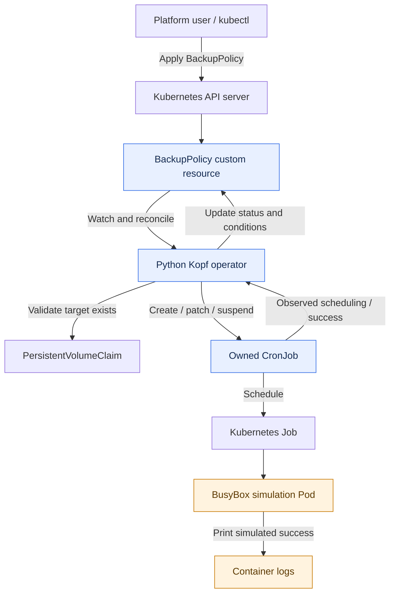
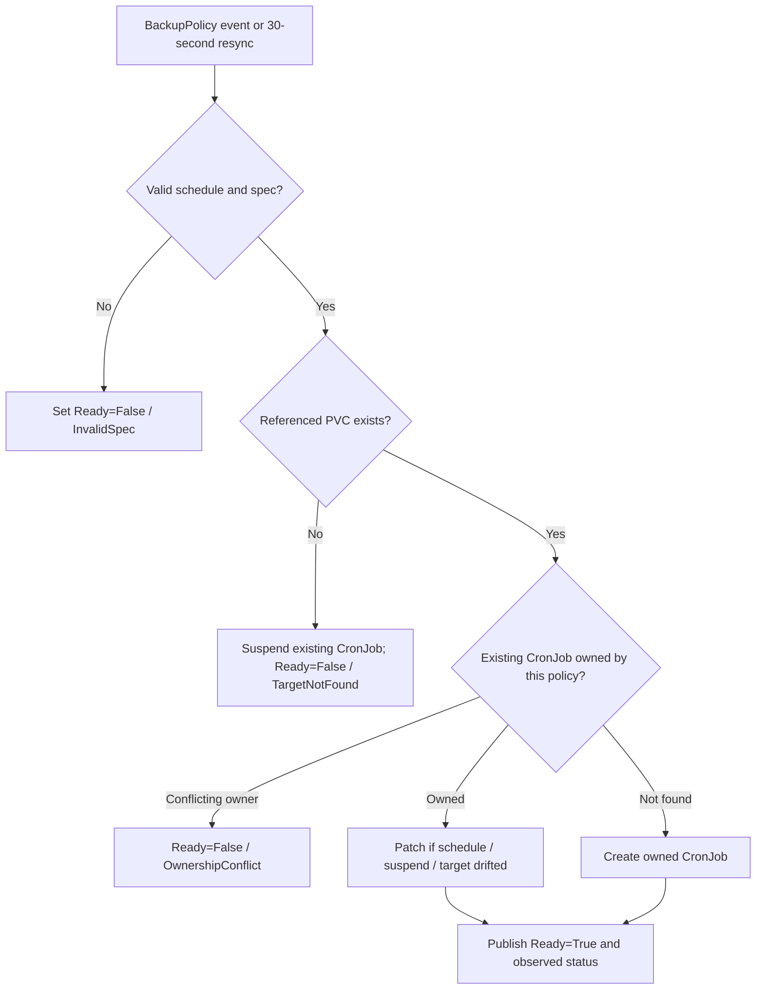
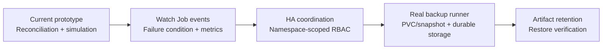

<div align="center">

# 🛡️ BackupPolicy Kubernetes Operator

### Declarative backup scheduling • Kubernetes-native reconciliation • Observable policy status

**Python** · **Kopf** · **Kubernetes CRDs** · **CronJobs** · **kind**

    

*A small, transparent Kubernetes operator that turns a `BackupPolicy` custom resource into a managed CronJob and reports reconciliation and simulated execution status.*

</div>

> [!IMPORTANT]
> **This is a backup simulator, not a data-protection product.** Jobs print a success message; they do not mount or read PVC data, store artifacts, or verify restores. `spec.retention` is validated but **not enforced**. `Ready=True` means reconciliation succeeded—not that data is protected.

## ✨ At a glance

| Capability | Implementation |
|---|---|
| Declarative policy | `BackupPolicy` CRD (`ops.example.com/v1alpha1`) |
| Native scheduling | Owned Kubernetes `CronJob` → `Job` → `Pod` |
| Continuous reconciliation | Kopf handlers plus periodic 30-second resync |
| Guardrails | Cron validation, PVC existence check, ownership conflict detection |
| Operational status | `Ready` condition, generation, active Jobs, last schedule and simulated success time |
| Lifecycle | Kubernetes owner-reference garbage collection and Kopf finalizer handling |
| Backup artifacts | **Not implemented** — simulation only |

## 🏗️ Architecture



**Responsibility boundary:** The operator reconciles desired state; Kubernetes CronJob schedules Jobs. The operator does **not** schedule Pods itself. A successful simulated Job does not mean PVC data was copied.

### Reconciliation decision flow



> [!NOTE]
> An invalid spec reports `InvalidSpec`, but a previously created CronJob is **not automatically suspended**. Missing PVCs suspend an existing CronJob; already-started Jobs are not canceled.

## 🚀 Quick start — local kind cluster

### Prerequisites

- Docker Desktop or a working Docker engine
- `kind` and `kubectl`
- Python **3.12+** for local unit tests

Run from the repository root:

```bash
kind create cluster --name backup-demo

docker build -t backuppolicy-operator:dev .
kind load docker-image backuppolicy-operator:dev --name backup-demo

kubectl apply -f crds/backuppolicy-crd.yaml
kubectl apply -f deploy/rbac.yaml
kubectl apply -f deploy/operator-deployment.yaml
kubectl rollout status deployment/backuppolicy-operator

kubectl apply -f examples/pvc.yaml
kubectl apply -f examples/backuppolicy.yaml

kubectl get backuppolicies,cronjobs,jobs
kubectl get backuppolicy app-data-backup -o yaml
kubectl logs deployment/backuppolicy-operator
```

The sample policy uses the `app-data` PVC and runs every minute. The PVC **must exist** for reconciliation, but it need not be `Bound` for this simulator. Wait until the next minute boundary, then inspect:

```bash
kubectl get jobs
kubectl logs job/<actual-job-name>
kubectl get backuppolicy app-data-backup -o yaml
```

Expected simulator log:

```text
Simulating backup for PVC app-data
Backup simulation successful
```

### Sample policy

The repository's canonical example is `examples/backuppolicy.yaml`. Its key fields are:

```yaml
apiVersion: ops.example.com/v1alpha1
kind: BackupPolicy
metadata:
  name: app-data-backup
spec:
  target:
    kind: PersistentVolumeClaim
    name: app-data
  schedule: "*/1 * * * *"
  retention: 24
  suspend: false
```

`retention: 24` describes a **proposed count of successful backup artifacts** to retain; this prototype does not create or prune those artifacts.

## 🧪 Hands-on scenarios

### 1. Change the schedule

**Bash / Linux / macOS:**

```bash
kubectl patch backuppolicy app-data-backup --type=merge -p '{"spec":{"schedule":"*/2 * * * *"}}'
kubectl get cronjob app-data-backup -o jsonpath='{.spec.schedule}'
```

**Windows PowerShell** (avoids shell quoting issues):

```powershell
'{"spec":{"schedule":"*/2 * * * *"}}' | Set-Content -Encoding ascii schedule-patch.json
kubectl patch backuppolicy app-data-backup --type=merge --patch-file schedule-patch.json
kubectl get cronjob app-data-backup -o jsonpath='{.spec.schedule}'
```

### 2. Suspend and resume

```bash
kubectl patch backuppolicy app-data-backup --type=merge -p '{"spec":{"suspend":true}}'
kubectl get cronjob app-data-backup -o jsonpath='{.spec.suspend}'

kubectl patch backuppolicy app-data-backup --type=merge -p '{"spec":{"suspend":false}}'
```

On PowerShell, use the same `--patch-file` pattern above with `{"spec":{"suspend":true}}` or `{"spec":{"suspend":false}}`.

### 3. Simulate a missing PVC

```bash
kubectl delete pvc app-data
# Allow up to 30 seconds for periodic reconciliation.
kubectl get backuppolicy app-data-backup -o yaml
kubectl get cronjob app-data-backup

kubectl apply -f examples/pvc.yaml
```

Expected: `Ready=False`, reason `TargetNotFound`; an existing CronJob is suspended. When the PVC reappears, reconciliation restores the policy's desired suspend state.

### 4. Invalid schedule

```bash
kubectl apply -f examples/invalid-policy.yaml
```

The CRD currently accepts the cron string; controller-side validation reports `Ready=False` / `InvalidSpec`. **Check that this example file exists in the repository before publishing this command.**

### 5. Unit tests

```bash
python -m pip install -r requirements.txt
python -m unittest discover -s tests -v
```

> Unit-test execution is **not yet verified in the shared session**. Run this command and record the outcome before claiming unit-test coverage.

## ✅ Verified live-cluster results

The following behaviors were manually exercised in a local kind cluster:

| Scenario | Result |
|---|---|
| Operator deploys and reconciles a policy | ✅ Passed |
| Creates an owned CronJob | ✅ Passed |
| Updates schedule (`*/1` → `*/2`) | ✅ Passed |
| Suspends and resumes CronJob | ✅ Passed |
| Reports invalid cron as `InvalidSpec` | ✅ Passed |
| Reports missing PVC as `TargetNotFound` and suspends CronJob | ✅ Passed |
| Recovers after PVC target is restored | ✅ Passed |
| Matches `observedGeneration` to resource generation | ✅ Passed |
| Deletes policy and garbage-collects CronJob | ✅ Passed |
| Recreates policy and executes scheduled Job | ✅ Passed |
| Reports last successful **simulated** execution | ✅ Passed |

**Observed Job:**

```text
NAME                       STATUS     COMPLETIONS   DURATION
app-data-backup-29863888   Complete   1/1           7s
```

**Observed logs:**

```text
Simulating backup for PVC app-data
Backup simulation successful
```

**Observed policy status (selected fields):**

```yaml
status:
  activeJobs: 0
  conditions:
    - type: Ready
      status: "True"
      reason: Reconciled
      message: "CronJob reconciled; retention=24 is design-only"
  lastScheduleTime: "2026-10-12T19:29:00+00:00"
  lastSuccessfulBackupTime: "2026-10-12T19:29:07+00:00"
  observedGeneration: 1
```

These results validate the **controller and simulator workflow**, not durable backups or restore capability.

## 🔐 RBAC and ownership

| Resource | Permissions | Purpose |
|---|---|---|
| `backuppolicies` | `get`, `list`, `watch`, `patch`, `update` | Observe resources and manage Kopf finalizers |
| `backuppolicies/status` | `get`, `patch`, `update` | Publish conditions and status |
| `cronjobs` | `get`, `list`, `watch`, `create`, `patch`, `update` | Reconcile owned schedules |
| `persistentvolumeclaims` | `get` | Confirm target exists |

The demo uses a `ClusterRole` and `ClusterRoleBinding` for convenient discovery. For production, narrow the watched namespaces and use namespaced `Role`/`RoleBinding` where possible. No Secret-read or CronJob-delete permission is intended.

**Deletion mechanics:** Kopf's finalizer coordinates its deletion lifecycle; the CronJob's Kubernetes owner reference enables garbage collection. A same-named CronJob with a different controller owner UID is **not** adopted (`OwnershipConflict`).

## 📈 Observability and alerts

**Implemented:** stdout controller logs, `Ready` condition and reason, observed generation, active Job count, last schedule timestamp and last successful simulated Job timestamp.

**Proposed, not implemented:** reconciliation count/duration/errors, `Ready=False` policy counts by reason, Job failure rates, age of last success, stuck Job counts, and missing-PVC counts.

Suggested alerts: `Ready=False` for over five minutes; no successful run for more than two expected intervals (excluding suspended policies); repeated Job failures; execution deadline exceeded; operator unavailable; and unschedulable Pods. A production version could export metrics to Prometheus and alert through Alertmanager.

## ⚙️ Reliability, scaling and tradeoffs

- **Idempotency:** Existing owned CronJobs are patched only when schedule, suspend or target drift is detected.
- **Periodic repair:** A 30-second resync detects target changes and configuration drift; status is currently patched every cycle.
- **Error handling:** Invalid configuration and missing PVC are represented in status. The periodic handler uses a 30-second `TemporaryError` retry delay for Kubernetes API failures.
- **Job safeguards:** `Forbid` concurrency, `startingDeadlineSeconds`, `backoffLimit`, and `activeDeadlineSeconds` bound overlaps and execution time.
- **Single replica:** Kopf runs with `--standalone`; **do not scale this deployment to multiple replicas**. HA requires tested coordination/leader election and appropriate RBAC.
- **Existing executions:** Suspending a policy or losing a PVC does not cancel Jobs already started.
- **Condition semantics:** `Ready=True` means the CronJob is reconciled, not that backup artifacts are durable. Job failures are not yet exposed as a separate `BackupHealthy` condition.
- **Validation gaps:** The operator does not verify PVC binding, access modes, data consistency or backup permissions.

## 🗂️ Retention strategy — design only

`spec.retention` is intended to specify how many **successful backup artifacts** to retain. Kubernetes CronJob `successfulJobsHistoryLimit` and `failedJobsHistoryLimit` affect **Job objects**, not stored backup artifacts.

A production implementation would upload verified artifacts to durable storage with policy UID, timestamp and backup ID; a cleanup worker would preserve the newest N successful artifacts and safely delete older ones. It would also account for legal holds, retention locks, partial uploads, idempotent cleanup, consistency and restore tests. **Never delete the only known-valid backup.**

## 🧱 Production hardening roadmap



Additional hardening: pin dependency versions and immutable image digests; publish SBOMs and signed images; add network policies and workload identity; encrypt data in transit and at rest; implement application-consistent snapshots/quiescing; and add kind integration tests. For multi-namespace use, constrain policy targets to the policy's namespace.

## 🤖 AI usage and engineering review

AI assistance helped draft the initial project skeleton, Kopf handlers, CRD, manifests and documentation. Engineering review focused on Kubernetes-native primitives, owner references, ownership conflict checks, accurate status semantics, and explicit limits of the simulation. AI-generated code was not treated as proof of correctness: live kind testing covered reconciliation, status, failure handling, cleanup and scheduled Job execution.

Important distinctions validated during review:

- Job history limits **do not** implement backup artifact retention.
- A single Kopf `--standalone` replica **does not** provide HA.
- A successful simulator Job **does not** prove backup integrity or recoverability.

## 🧹 Cleanup

```bash
kind delete cluster --name backup-demo
```

---

<div align="center">

**Built to demonstrate Kubernetes operator design, reconciliation, lifecycle management and operational clarity — without overstating simulated backup functionality.**

</div>
